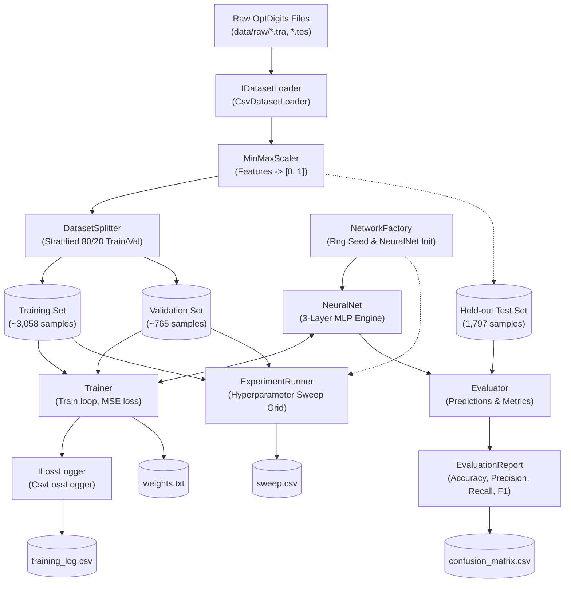

# Architecture & System Design

This document details the modular architecture of the handwritten digit classifier, component relationships, data flow, and ownership boundaries between Partner A and Partner B.

---

## 1. System Data Flow

## 2. Separation of Concerns & Clean Architecture
1. **Engine Independence**:
   `Backprop.Engine` has zero external dependencies and does not know about the CLI, dataset formats, or evaluation metrics.
2. **Deterministic Reproducibility**:
   All random operations (initial network weights and stratified data splitting) are seeded via `Rng.Seed(options.Seed)` and `Random(options.Seed)`.
3. **Data Leakage Prevention**:
   The `MinMaxScaler` is fitted strictly on the training set. The held-out test set (`optdigits.tes`) is never seen during training or parameter tuning.
