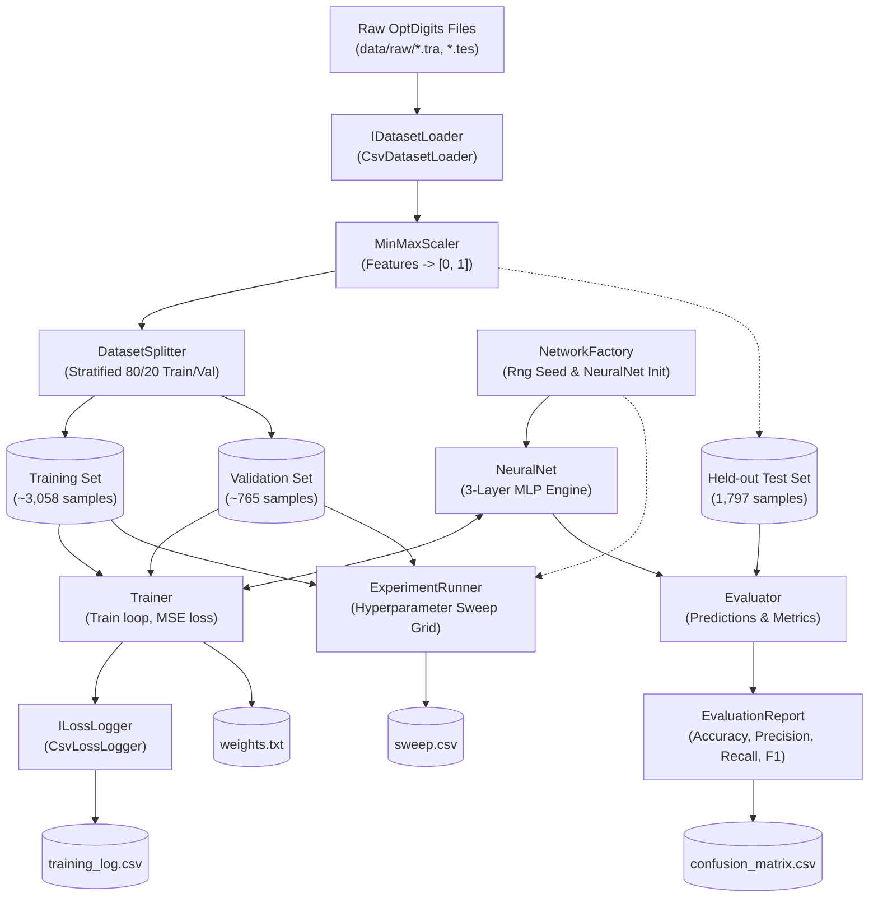

# Architecture & System Design

This document details the modular architecture of the handwritten digit classifier, component relationships, data flow, and ownership boundaries between Partner A and Partner B.

---

## 1. System Data Flow

---

## 2. Module Responsibilities and Ownership

| Module / Component | Namespace | File Path | Responsibility | Owner |
| :--- | :--- | :--- | :--- | :--- |
| **Engine: InputNeuron** | `Backprop` | `src/Backprop.Engine/InputNeuron.cs` | Stores input feature activations, outgoing weights to hidden layer, and weight update delta math. | Partner A |
| **Engine: HiddenNeuron** | `Backprop` | `src/Backprop.Engine/HiddenNeuron.cs` | Computes sigmoid hidden activations, backward error gradient propagation, and hidden weight/bias updates. | Partner A |
| **Engine: OutputNeuron** | `Backprop` | `src/Backprop.Engine/OutputNeuron.cs` | Stores output layer activations, class bias, and output delta computations. | Partner A |
| **Engine: NeuralNet** | `Backprop` | `src/Backprop.Engine/NeuralNet.cs` | Orchestrates 3-layer feedforward pass (`run()`), stochastic gradient descent backpropagation (`learn()`), argmax prediction (`Predict()`), and weight serialization. | Partner A |
| **Engine: Rng** | `Backprop` | `src/Backprop.Engine/Rng.cs` | Seedable deterministic pseudo-random weight and bias initialization generator $[-0.5, 0.5)$. | Partner A |
| **Data: Sample** | `OptDigits.Data` | `src/OptDigits.App/Data/Sample.cs` | Immutable record representing feature vector and integer class label. | Shared |
| **Data: CsvDatasetLoader** | `OptDigits.Data` | `src/OptDigits.App/Data/CsvDatasetLoader.cs` | Reads and parses 65-column comma-separated optdigits raw files into structured `Sample` records. | Partner B |
| **Data: MinMaxScaler** | `OptDigits.Data` | `src/OptDigits.App/Data/MinMaxScaler.cs` | Fits min/max bounds on training data and transforms feature arrays into normalized $[0, 1]$ interval. | Partner B |
| **Data: LabelEncoder** | `OptDigits.Data` | `src/OptDigits.App/Data/LabelEncoder.cs` | Generates 10-dimensional one-hot target vectors and argmax decoding for class index retrieval. | Partner B |
| **Data: DatasetSplitter** | `OptDigits.Data` | `src/OptDigits.App/Data/DatasetSplitter.cs` | Splits training samples into stratified 80% train and 20% validation subsets. | Partner B |
| **Training: TrainingOptions** | `OptDigits.Training` | `src/OptDigits.App/Training/TrainingOptions.cs` | Parameter record containing learning rates, hidden layer dimensions, epochs, seed, and log frequency. | Shared |
| **Training: EpochMetrics** | `OptDigits.Training` | `src/OptDigits.App/Training/EpochMetrics.cs` | Snapshot record holding epoch number, train MSE loss, validation MSE loss, and validation accuracy. | Shared |
| **Training: TrainingResult** | `OptDigits.Training` | `src/OptDigits.App/Training/TrainingResult.cs` | Summary of completed training session containing metrics history and execution duration. | Shared |
| **Training: CsvLossLogger** | `OptDigits.Training` | `src/OptDigits.App/Training/CsvLossLogger.cs` | Stream writer writing `training_log.csv` and echoing training progress to console. | Partner A |
| **Training: Trainer** | `OptDigits.Training` | `src/OptDigits.App/Training/Trainer.cs` | Executes training loop, feeds inputs and targets, triggers backpropagation, and computes MSE loss. | Partner A |
| **Evaluation: ClassMetrics** | `OptDigits.Evaluation` | `src/OptDigits.App/Evaluation/ClassMetrics.cs` | Container for per-digit precision, recall, F1-score, and support metrics. | Shared |
| **Evaluation: EvaluationReport** | `OptDigits.Evaluation` | `src/OptDigits.App/Evaluation/EvaluationReport.cs` | Formats classification report tables and serializes 10x10 confusion matrix CSV. | Partner B |
| **Evaluation: Evaluator** | `OptDigits.Evaluation` | `src/OptDigits.App/Evaluation/Evaluator.cs` | Runs inference over evaluation samples, constructs confusion matrix, and computes performance scores. | Partner B |
| **Experiments: Grid & Row** | `OptDigits.Experiments` | `src/OptDigits.App/Experiments/ExperimentGrid.cs` | Search grid definition and trial result container. | Shared |
| **Experiments: ExperimentRunner** | `OptDigits.Experiments` | `src/OptDigits.App/Experiments/ExperimentRunner.cs` | Executes automated grid search over learning rates, hidden sizes, and epochs; logs `sweep.csv`. | Partner A |
| **App: Program & Paths** | `OptDigits.App` | `src/OptDigits.App/Program.cs` | Thin CLI orchestrator handling `train`, `sweep`, `evaluate` commands and environment path discovery. | Shared |
| **Tools & Visualization** | External | `tools/` | Automated dataset download scripts (`.sh`, `.ps1`) and matplotlib loss/confusion matrix plotting. | Partner B |

---

## 3. Separation of Concerns & Clean Architecture
1. **Engine Independence**:
   `Backprop.Engine` has zero external dependencies and does not know about the CLI, dataset formats, or evaluation metrics.
2. **Deterministic Reproducibility**:
   All random operations (initial network weights and stratified data splitting) are seeded via `Rng.Seed(options.Seed)` and `Random(options.Seed)`.
3. **Data Leakage Prevention**:
   The `MinMaxScaler` is fitted strictly on the training set. The held-out test set (`optdigits.tes`) is never seen during training or parameter tuning.
